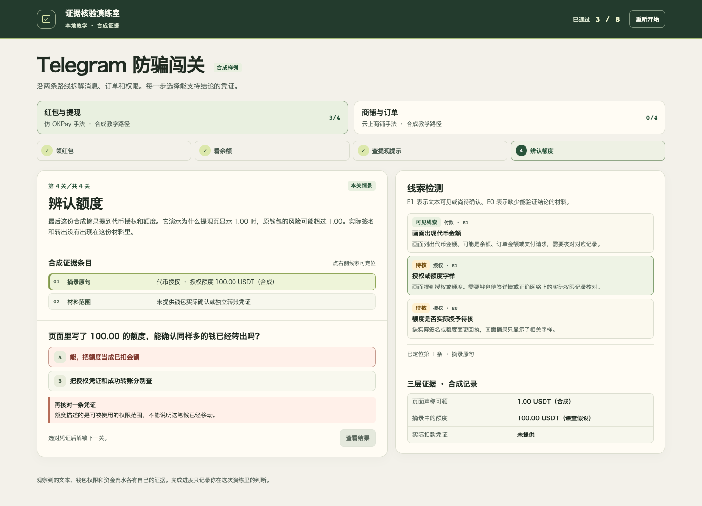

# Telegram 防骗证据复核

一个离线的截图和视频线索标记工具。可识别机器人与消息归因、外链提示、付款请求和授权相关文字。结果按证据来源展示，用于人工复核。

公开仓库中的演示素材是独立绘制的教学图。它没有 Telegram 登录、商铺、收款或钱包功能。使用真实材料时，把输入清单、素材和分析结果放在本地，由使用者自行保管。

## 玩本地防骗闯关

下载或克隆后，用浏览器打开 [training.html](training.html)。页面不需要终端、服务器或联网。先选四步路线，按顺序完成合成操作。全部操作结束后再做复盘判断。

每次操作后，浏览器用从 `rules.py` 生成的规则重新扫当前模拟证据。点选线索可定位原文字段，缺材料会标成待核。公开页面旁边是合成对照，操作只改变本地演练状态。



在 `training/lessons.json` 编辑关卡，页面结构在 `training/index.template.html`。

```sh
python3 -B build_training.py
python3 -B build_training.py --check
python3 -B -m unittest -v test_rules test_training test_training_bot
```

### Telegram 教学消息和本机机器人

[纸舟课堂的八条模拟演练消息](training/telegram-posts.json)按关卡 ID 保存，覆盖红包、余额、提现、授权提示、订单、外链和付款。每条用练习点和虚构订单讲解如何核验一项线索。

```sh
python3 -B training_bot.py
```

选一条路线后，每按一次回车完成一步、增加一个课堂进度点，再显示对应的风险线索和待核项。也可附加 `--route gift` 或 `--route shop` 直接启动路线。机器人是终端内的离线教学程序。

### 本地截图对照

构建器支持 `--history`，公开版即使没有原图也能完整练习。历史清单是以关卡 ID 为键、已脱敏本地 PNG/JPEG 路径为值的 JSON。清单要包含 `training/lessons.json` 里的八个关卡 ID。路径相对于清单文件。命令示例：

```sh
python3 -B build_training.py --history /path/to/local-history.json --output /path/to/local-walkthrough.html
```

生成的本机页在对应关卡旁嵌入原截图。构建器要求带历史截图的页面写到 Git 工作区之外。请仅在已获授权时整理、保存这些材料，真实截图和本机产物保持本地。

用 `--telegram /path/to/telegram-teaching.json` 加入自己的 Telegram 演练截图。该清单的八个关卡 ID 各对应一个 `{"file": "screens/step.jpg", "reference": "模拟演练 1/8 · 领红包"}` 对象，图片路径相对于清单文件。可同时使用 `--history`，每关会分别显示演练截图与案件历史画面。用 `--channel` 加入自己控制的公开 Telegram 频道主页链接，页面只会在用户点击时打开该链接。

## 运行教学样例

默认 OCR 需要 macOS Apple Vision、Swift 命令行工具和 Python 3.9+。视频额外需要 PATH 中的 FFmpeg 和 FFprobe。截图模式无需 FFmpeg。初次运行会在 `.build/` 编译本地 OCR 助手，不安装 Python 依赖。

```sh
python3 review.py --manifest demo.json --output .local/demo-01
```

在本机浏览器打开 `.local/demo-01/report.html`。点击一条结果可以查看原图位置，或跳到原视频时间码。也可以读取 `findings.json`。每次运行使用一个新输出目录。

```sh
python3 -B -m unittest -v test_rules
```

## 导入自己的材料

清单中的路径相对于清单文件。源文件需要在打开报告的机器上保持可读。视频默认每三秒取样，同时加上清单中的 `checkpoints` 和人工条目的时间点。`--interval 2` 可改为每两秒一次。

```json
{
  "title": "本地复核",
  "mode": "local",
  "sources": [
    {"id": "image1", "kind": "image", "path": "screenshot.png", "label": "原截图", "reference": "帖子 #1"},
    {"id": "video1", "kind": "video", "path": "recording.mp4", "label": "原视频", "reference": "帖子 #2", "checkpoints": [12.75]}
  ],
  "reviewed": [
    {
      "source_id": "video1", "category": "payment", "status": "pending", "grade": "E0",
      "timestamp": 12.75, "box": null, "title": "实际扣款待核",
      "summary": "仅见付款请求，需独立流水。"
    }
  ]
}
```

`box` 是原画面左上原点下归一化的 `[x, y, width, height]`，可省略。人工录入的 E2 表示复核过的可见内容，凭证缺失用 E0，待确认文字或声明用 E1。OCR 提取是 E1，不能证实账号归属、成功付款或实际授权。视频是取样；未命中不能证明未出现。相邻视频帧重复出现同一线索时，列表只留连续区间的起始线索。

## 数据与实现边界

- `review.py` 读取显式列出的本地文件，保存来源指纹、证据引用和结果。
- `ocr.swift` 使用 Apple Vision，原始 OCR 文字只经过本地进程管道。
- `rules.py` 静态处理 OCR 和链接字样，输出固定文字及定位。OCR 不会把原始域名、账号、交易编号放进报告。
- `report.py` 生成静态 HTML。证据在本机取阅，报告链接会引用本机源文件。
- MVP 没有收款、登录、钱包操作、链上查询和跟随外链模块。实际资金动作仍要看独立付款回执或链上记录。
- 需要换 OCR 引擎时，可通过 `--ocr-bin /absolute/path/to/helper` 使用本机兼容程序。其 stdin 逐行接收 `{"id":"…","data":"base64 图像"}`，stdout 逐行返回含 `id`、`width`、`height`、`lines` 的 JSON。每个 `lines` 元素含 `text`、归一化 `box` 与 `confidence`，坏图返回 `error`。

源码与合成样例使用 MIT 许可。Swift、macOS Vision 与 FFmpeg 来自运行环境，遵循各自许可。
